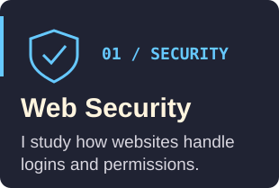
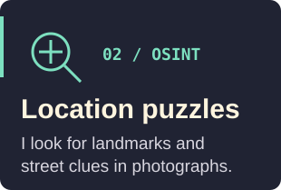
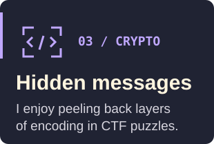

## Hey, I’m Abdelrahman 👋

I’m Abdelrahman, a web developer from Cairo with a focus on web security. I’m interested in how websites handle authentication and access control. I also enjoy solving OSINT and cryptography puzzles in CTFs.

## What I’m into

  

## My toolkit

     

[Explore my portfolio ↗](https://asaleh.xyz)

<!-- activity -->
<!-- /activity -->
