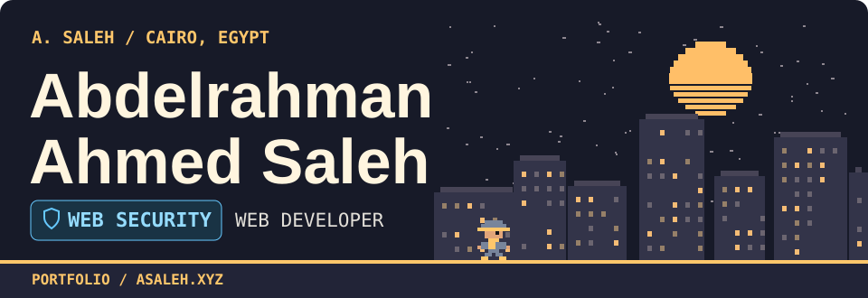

I build websites, design circuit boards, and play capture-the-flag challenges. My personal portfolio has a little pixel character that walks across the top of the page. On the hardware side, I’ve been working on fitting an ALU onto a two-layer board.

## Selected work

| Project | What I worked on |
| --- | --- |
| [Pixel portfolio](https://asaleh.xyz) | A personal site with a pixel-art guide and an animated header. |
| ALU circuit board | Placed components in KiCad, routed traces across two copper layers, and checked the layout for clearance and connection errors. |
| AES-256 on Kali Linux | Encrypted a file, decrypted it with the same password, and documented both steps in a practical report. |

## CTF interests

I enjoy OSINT challenges that start with a single photograph, forensics puzzles with clues hidden in files, and crypto challenges where several layers of encoding hide the message.

## My toolkit

`HTML` · `CSS` · `JavaScript` · `Python` · `C++` · `KiCad` · `Proteus` · `Kali Linux`

<!-- activity -->
## GitHub activity

[@asaleh007](https://github.com/asaleh007) · [Repositories](https://github.com/asaleh007?tab=repositories)

<!-- /activity -->
